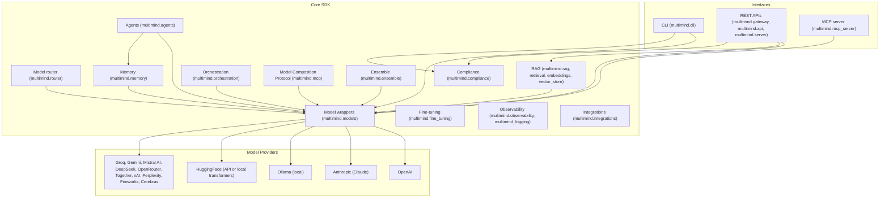
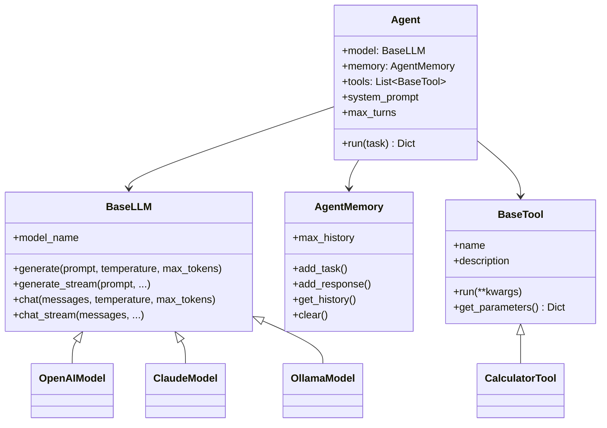
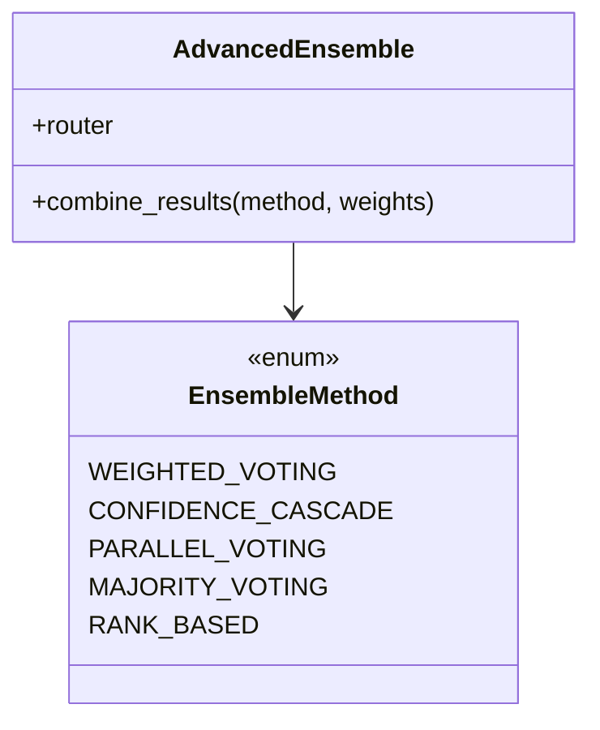
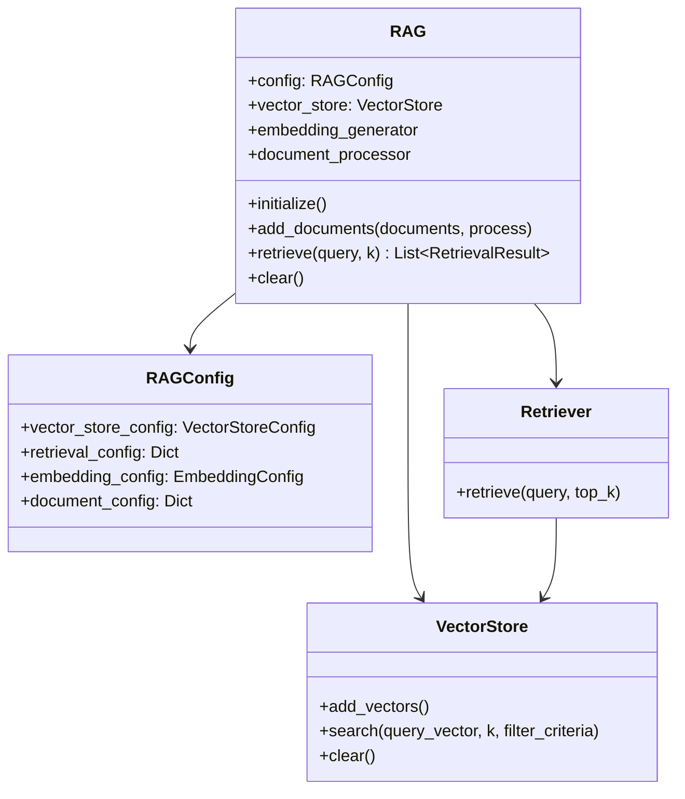
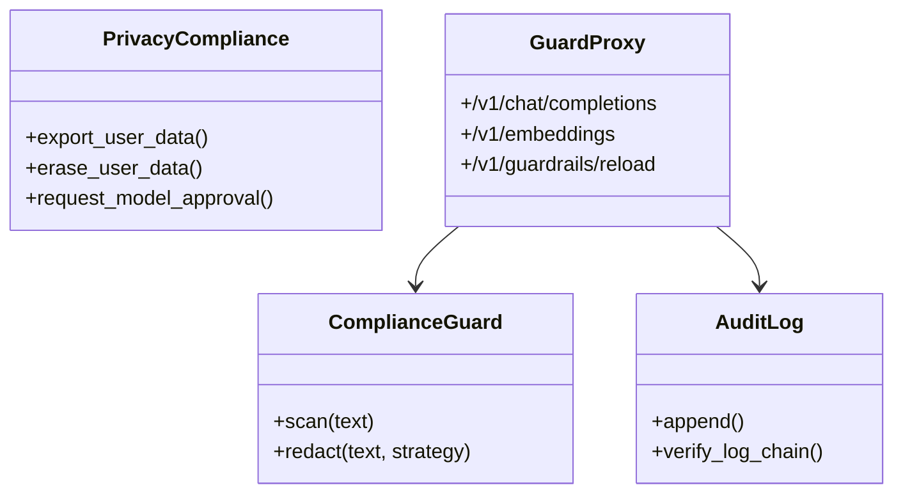
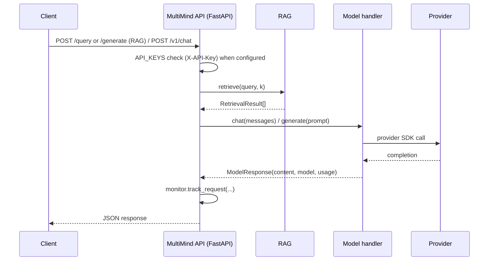
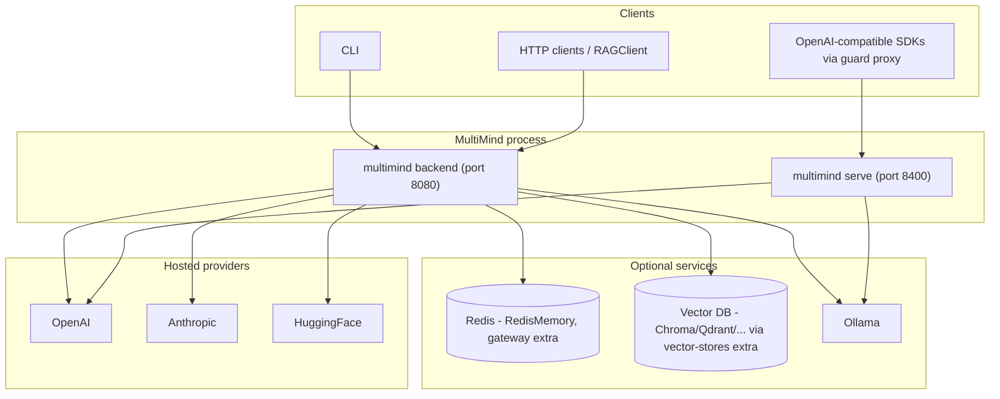

This document gives an overview of how the MultiMind SDK is put together: the packages under `multimind/`, how they depend on each other, and how a request flows through them. Every component named here corresponds to a real module; status (stable / beta / planned) is tracked in [feature-status.md](/feature-status).

## System Overview

## Model Providers

`multimind.models` ships one wrapper class per provider, all deriving from `BaseLLM`:

| Wrapper | Provider | Notes |
|---------|----------|-------|
| `OpenAIModel` | OpenAI | chat, generate, embeddings, streaming |
| `ClaudeModel` | Anthropic | chat, generate, streaming |
| `OllamaModel` (`MistralModel` alias) | Ollama | local models over HTTP, no extra needed |
| `HuggingFaceModel` | HuggingFace | Inference API, or local `transformers` when installed |
| `GroqModel`, `GeminiModel`, `MistralAIModel`, `DeepSeekModel`, `OpenRouterModel`, `TogetherModel`, `XAIModel`, `PerplexityModel`, `FireworksModel`, `CerebrasModel` | respective APIs | OpenAI-compatible or native clients |
| `MultiModelWrapper` | several | primary model with fallbacks and weights |

Non-transformer architectures live in `multimind.llm.non_transformer_llm`; `MambaLLM` and `RWKVLLM` run real (HuggingFace-backed) inference, the other classes there (S4 variants, Hyena, RetNet, MLP-only, diffusion text, ...) are extension scaffolds that raise `NotImplementedError`.

`BaseLLM` defines the shared interface: `generate`, `generate_stream`, `chat`, `chat_stream`, plus `embeddings` where the provider supports it. Model-provider errors surface as `multimind.core.exceptions` types.

## Component Details

### Core: models, agents, tools

When the model exposes an OpenAI-compatible client, `Agent` offers tools as native function definitions and runs a bounded tool-call loop (`max_turns`); otherwise it falls back to keyword-based tool routing. `CalculatorTool` is the only built-in tool; other tools are `BaseTool` subclasses you provide. `multimind.agents` also exports `AgentOrchestrator` (with `AgentSpec`, `AgentNode`, `OrchestrationResult`), `SelfEvolvingAgent` and `AgentLoader` (agents configured from MCP workflow files); `multimind.agents.react_toolchain.ReasoningChain` runs ReAct-style reasoning steps.

### Routing

`multimind.router` provides `Router` with pluggable strategies (`strategy.py`: cost-aware, latency-aware, hybrid), a `fallback.py` chain, an `adaptive.py` router and a `multi_modal_router.py`. `multimind.client.FederatedRouter` routes between local and cloud models on input size, latency and privacy constraints, and `multimind.client.model_client` holds the `ModelClient` family (`LSTMModelClient`, `RNNModelClient`, `GRUModelClient`, `MoEModelClient`, `DynamicMoEModelClient`, `MultiModalClient`).

### Ensemble

`multimind.ensemble.advanced.AdvancedEnsemble` combines results from several providers registered on a router. The five methods above are the ones in the `EnsembleMethod` enum. [examples/api/ensemble_api.py](https://github.com/multimindlab/multimind-sdk/blob/develop/examples/api/ensemble_api.py) wraps it in a FastAPI app.

### Orchestration and the Model Composition Protocol

`multimind.orchestration` has two pieces: `PromptChain` (multi-step prompts with variable substitution) and `TaskRunner` (task dependencies, retries, parallel execution). There is no separate scheduler, resource manager, state manager or event bus.

`multimind.mcp` is MultiMind's own **Model Composition Protocol**: `parser.py` validates a JSON/YAML workflow against `schema.json`, and `executor.py` / `advanced_executor.py` run the steps against registered models. It is unrelated to Anthropic's Model Context Protocol, which is served separately by `multimind.mcp_server` (`python -m multimind.mcp_server`, `mcp` extra; see [mcp-server.md](/mcp-server)).

### RAG

`VectorStore` dispatches to one of ~60 backends in `multimind.vector_store` (FAISS and Chroma are the most exercised; see [feature-status.md](/feature-status#vector-store-backends) for which backends are real, partial or `NotImplementedError` stubs). `multimind.retrieval` also provides `EnhancedRetriever` and `HybridRetriever`; `multimind.rag` adds `GraphRetriever`, `PostProcessor` and the fluent `RAGPipeline`. Details: [rag.md](/rag).

### Fine-tuning

`multimind.fine_tuning` contains `lora_trainer.py`, `qlora_trainer.py` (real 4-bit NF4 + LoRA when `[finetune-gpu]` deps are present), adapter/PEFT modules (`unified_peft.py`, `advanced_unified_peft.py`, `peft_methods.py`, `ia3_bitfit.py`, `mam_adapter.py`, ...), meta-learning modules and `rag_fine_tuner.py` / `synthetic_data.py` for generating instruction-tuning data from documents. There is no model registry, versioning or deployment subsystem; training outputs are plain checkpoints. Everything here needs the `finetune` extra (torch, transformers, peft, optuna).

### Memory

`multimind.memory` exports `BaseMemory` (five async methods: `add_message`, `get_messages`, `clear`, `save`, `load`) and about fifty implementations, from `BufferMemory` and `SummaryMemory` to `VectorStoreMemory`, `KnowledgeGraphMemory` and `HybridMemory`. A number of the more exotic classes (quantum simulations, HTM, spiking, Bayesian, fast-weight, adapter) are abstract scaffolds that cannot be instantiated. The full list with status is in [memory.md](/memory).

### Compliance and governance

`multimind.compliance` implements PII detection/redaction (`ComplianceGuard`), GDPR/HIPAA-style privacy models (`privacy.py`, including a `ComplianceTraining` record type), hash-chained audit logging, cost tracking and regulation checkers. `multimind.gateway.guard_proxy` exposes these as an OpenAI-compatible proxy (`multimind serve`), and `multimind.gateway.compliance_api` mounts the `/v1/compliance/*` routes. Dashboards need the `compliance` extra (plotly, dash).

### Observability

`multimind.multimind_logging` provides `trace_logger.py` and `usage_tracker.py` (token/cost accounting with JSON/CSV export); `multimind.observability` and `multimind.metrics` add tracing hooks and cost reports used by `multimind audit costs` and the governance dashboard (`multimind dashboard`). The gateway has its own in-process `ModelMonitor` (per-model request/latency/error metrics, health checks and rate limits) in `multimind.core.monitoring`.

### Interfaces

- **CLI** (`multimind`): `chat`, `models`, `config`, `compliance`, `audit`, `serve` (guard proxy), `dashboard`, `backend` (the combined REST API) and `convert`. See [cli.md](/cli).
- **REST**: `multimind.server.platform.create_platform_app()` ("MultiMind API", served by `multimind backend` on port 8080) merges the gateway, compliance, dashboard `/api/*`, guard-proxy and RAG routes behind one Swagger UI. The individual apps (`multimind.gateway.api`, `multimind.gateway.rag_api`, `multimind.api.multi_model_api`, `multimind.api.unified_api`) can still be run on their own. See [api_reference/overview.md](/api_reference/overview).
- **MCP server** (`python -m multimind.mcp_server`): exposes MultiMind tools to Anthropic Model Context Protocol clients.

There is no WebSocket API; streaming is done through the async `*_stream` model methods in Python and through SSE on the OpenAI-compatible proxy.

## Data Flow

A typical RAG-augmented request through the combined API:

## Deployment Architecture

The default vector store is in-process FAISS; Redis and external vector databases are opt-in. See [deployment.md](/deployment) for Docker and environment details.

## Configuration

Configuration is environment-first. `multimind.core.config.GatewayConfig` (re-exported as `multimind.gateway.config.config`) loads a `.env` file via `python-dotenv` and reads one `ModelConfig` section per provider from `*_API_KEY` / `*_MODEL_NAME` variables plus `DEFAULT_MODEL` and `LOG_LEVEL`. The guard proxy and dashboard read `MULTIMIND_PROXY_*` and `MULTIMIND_DASHBOARD_*`; the CLI stores its own defaults in `~/.multimind_cli_config`. `API_KEYS` turns on `X-API-Key` authentication for the HTTP apps and `MULTIMIND_CORS_ORIGINS` enables CORS. Full list: [configuration.md](/configuration).

## Security Architecture

- **Authentication**: `API_KEYS` (comma-separated) gates every non-health route of the combined API, the multi-model API and the RAG API; the RAG API additionally supports JWT bearer tokens issued by `POST /token` when `JWT_SECRET` and `JWT_USERS_JSON` (bcrypt hashes) are set. When neither is configured the servers are open, which is intended for local development only.
- **Audit logging**: hash-chained JSONL audit trails from the guard proxy and compliance modules (`verify_log_chain`).
- **Privacy controls**: PII detection and redaction (`mask`, `hash`, `remove`) on requests and, optionally, responses.
- **Secrets**: provider keys are read from the environment and never logged; the shadow-AI scan (`multimind audit scan`) flags hardcoded keys in a codebase.

There is no built-in role-based access control or at-rest encryption layer; put the API behind your own gateway/TLS termination for production.
