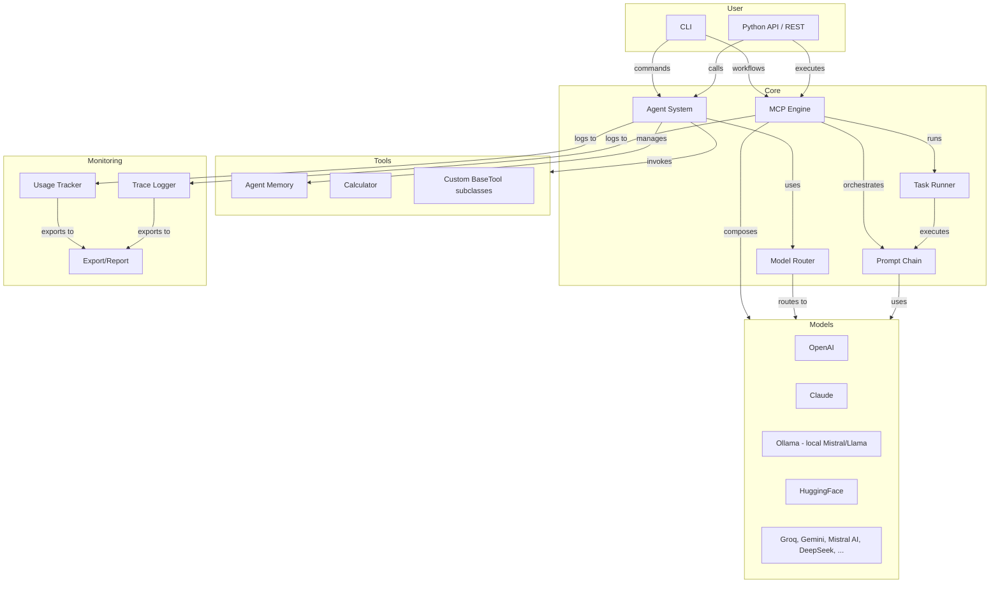

> For the authoritative, per-feature status (Stable / Beta / Planned), see [feature-status.md](/feature-status). This page gives a structural overview; items marked "Planned" below are not implemented yet.

## Project Structure

The main packages under `multimind/` (see the repository for the full tree):

```
multimind-sdk/
├── multimind/
│   ├── __init__.py                # Public API; heavy features are lazy-imported per extra
│   ├── _lazy.py                   # Lazy attribute loader used by the package
│   ├── main_config.py             # Central config loader
│   ├── config/                    # Config helpers
│   ├── core/                      # Gateway config, chat sessions, monitoring, exceptions
│   ├── models/                    # Model wrappers: openai.py, claude.py, ollama.py, huggingface.py,
│   │                              #   groq.py, gemini.py, mistral.py, deepseek.py, openrouter.py,
│   │                              #   together.py, xai.py, perplexity.py, fireworks.py, cerebras.py,
│   │                              #   multi_model.py, factory.py, moe/
│   ├── llm/                       # Non-transformer LLMs (Mamba, RWKV, scaffolds), model registry
│   ├── router/                    # router.py, strategy.py, fallback.py, adaptive.py, multi_modal_router.py
│   ├── rag/                       # rag.py (RAG, RAGConfig), base.py, fluent.py, graph_retrieval.py, postprocessing.py
│   ├── retrieval/                 # Retriever, EnhancedRetriever, HybridRetriever
│   ├── embeddings/                # EmbeddingConfig, EmbeddingModel
│   ├── vector_store/              # VectorStore + ~60 backends (FAISS, Chroma, Qdrant, ...)
│   ├── document_loader/           # File/data ingestion
│   ├── document_processing/       # Chunkers and processors
│   ├── fine_tuning/               # lora_trainer.py, qlora_trainer.py, PEFT and meta-learning modules
│   ├── agents/                    # agent.py, memory.py, agent_loader.py, agent_registry.py, tools/ (calculator.py)
│   ├── memory/                    # ~50 memory classes (see memory.md)
│   ├── orchestration/             # prompt_chain.py, task_runner.py
│   ├── mcp/                       # Model Composition Protocol: parser.py, executor.py, schema.json
│   ├── mcp_server/                # Anthropic Model Context Protocol server
│   ├── ensemble/                  # AdvancedEnsemble and ensemble methods
│   ├── compliance/                # PII guard, privacy, audit, regulation checkers
│   ├── integrations/              # github.py, slack.py, discord.py, jira.py, model_adapters.py, frameworks/
│   ├── multimind_logging/         # trace_logger.py, usage_tracker.py
│   ├── observability/, metrics/   # Tracing and cost metrics
│   ├── gateway/                   # FastAPI apps: api.py, rag_api.py, compliance_api.py, guard_proxy.py
│   ├── api/                       # multi_model_api.py, unified_api.py
│   ├── server/                    # MultiMindServer base app and platform.py (combined "MultiMind API")
│   ├── dashboard/                 # Governance dashboard
│   ├── client/                    # RAGClient, ModelClient family, FederatedRouter, ModelSession
│   └── cli/                       # click CLI: chat, models, config, compliance, audit, serve, dashboard, backend
├── examples/                      # Example scripts (see examples/README.md)
├── tests/                         # Test suite
├── docs/                          # Documentation
├── README.md
├── LICENSE
├── pyproject.toml
└── setup.py
```

---

## Core Features

### Model Support

- **Model Wrappers (available today):**
  - OpenAI, Anthropic Claude, Ollama (local models, including Mistral and Llama), HuggingFace (Inference API or local transformers)
  - Groq, Google Gemini, Mistral AI, DeepSeek, OpenRouter, Together, xAI, Perplexity, Fireworks, Cerebras
  - `MultiModelWrapper` for primary + fallback models
- **Unified Interface:** All wrappers derive from `BaseLLM` and support `generate`, `chat` and streaming (`generate_stream`, `chat_stream`); `embeddings` where the provider offers it
- **Non-Transformer Inference:** Mamba and RWKV run via HuggingFace-backed wrappers; other listed architectures are extension scaffolds that raise `NotImplementedError`

### Agent System

- **Agent Framework (available today):**
  - `Agent(model, memory, tools, system_prompt, max_turns)` with native function calling on OpenAI-compatible models and keyword-based tool routing elsewhere
  - `AgentMemory` for task/response history
  - Agent configuration loading from MCP workflow files (`agent_loader`)
  - One built-in tool (`CalculatorTool`); extensible via `BaseTool` subclasses
  - `AgentOrchestrator`, `SelfEvolvingAgent`, `ReasoningChain` (ReAct-style steps)
- **Planned:** hierarchical multi-agent systems, inter-agent communication, AutoML-based agent configuration, additional built-in tools (web search, file operations)

### Orchestration

- **Prompt Chains:** multi-step workflows with variable substitution and conditional execution
- **Task Runner:** task dependencies, retry logic, context management, parallel execution

### Model Composition Protocol (MCP)

> Note: `multimind.mcp` is MultiMind's own **Model Composition Protocol**, a JSON/YAML workflow executor for chaining models. Anthropic's **Model Context Protocol** is supported separately by `multimind.mcp_server` (`pip install "multimind-sdk[mcp]"`, `python -m multimind.mcp_server`; see [mcp-server.md](/mcp-server)).

- **Workflow Definition:** JSON/YAML workflow specification validated against `schema.json`; model composition and chaining; conditional execution; data transformation
- **Execution Engine:** workflow validation, model registration, step execution, error handling (`executor.py`, `advanced_executor.py`)

### Routing & Strategy

- **Model Router:** strategy-based routing (cost-aware, latency-aware, hybrid), fallback chain, adaptive and multi-modal routers
- **Federated routing:** `multimind.client.FederatedRouter` chooses local vs. cloud models by input size, latency and privacy

### Fine-Tuning & PEFT

- **Available today (basic):** LoRA and adapter training; QLoRA (real 4-bit NF4 + LoRA when the `[finetune-gpu]` deps are installed); synthetic Q/A generation for RAG fine-tuning (`SyntheticQAGenerator`, no torch needed)
- **Experimental / partially implemented:** IA³, BitFit, MAM adapters, UniPELT, meta-learning (MAML, Reptile), adaptive PEFT
- **Planned:** HyperLoRA, Compacter, AutoML-based parameter tuning, advanced optimization

### RAG (Retrieval-Augmented Generation)

- **Vector stores:** FAISS and Chroma are the most exercised; Pinecone, Qdrant, Weaviate, Milvus, Zilliz, Elasticsearch, OpenSearch, MongoDB Atlas, the PostgreSQL family and ~25 other client-backed stores are implemented; eleven backends are `NotImplementedError` stubs (full list in [feature-status.md](/feature-status#vector-store-backends))
- **Retrieval:** `RAG.retrieve`, `EnhancedRetriever`, `HybridRetriever`, `GraphRetriever` (entity-graph expansion), post-processing, fluent `RAGPipeline`
- **Known limitation:** `RAG.retrieve(filter_criteria=...)` currently raises; filter on result metadata instead (see [rag.md](/rag#1-metadata-filtering))
- **Planned:** self-tuning indexer, quantum-enhanced search

### Enterprise Integration

- **Compliance Suite (available today):** PII detection and redaction, GDPR/HIPAA policy modeling, hash-chained audit logging, cost chargeback, OpenAI-compatible guard proxy (`multimind serve`), compliance dashboards (with the `[compliance]` extra)
- **Service Integrations (available today):** GitHub, Slack, Discord, Jira adapters in `multimind.integrations`; framework adapters for LangChain, LlamaIndex, CrewAI, AutoGen and Haystack in `multimind.integrations.frameworks` (each has its own extra)
- **Planned:** edge deployment toolkit, plugin system (Notion, Salesforce), database connectors, real-time data integration (Kafka, MQTT)

### Development Tools

- **Available today:** governance dashboard (`multimind dashboard`), shadow-AI inventory scan (`multimind audit scan`), combined Swagger UI (`multimind backend`)
- **Planned:** visual workflow builder, drag-and-drop components, no-code interface

### Logging & Monitoring

- **Usage Tracking:** token usage, cost tracking, operation logging (`multimind_logging.usage_tracker`)
- **Trace Logging:** request/response tracing, performance metrics, error tracking (`multimind_logging.trace_logger`)
- **Gateway metrics:** per-model request counts, latency, error counts, health checks and rate limits (`multimind.core.monitoring`), exposed at `GET /v1/metrics`
- **Export & Reporting:** JSON/CSV export, usage summaries, cost chargeback (`multimind audit costs`)

### Configuration

- YAML/JSON config files, `.env` and environment variable support (`python-dotenv` is loaded automatically)
- CLI defaults in `~/.multimind_cli_config` (`multimind config manage`)

### CLI & Integration

- **CLI (`multimind`):** `chat`, `models` (list/compare/health/metrics/download/export/delete), `config`, `compliance`, `audit`, `serve`, `dashboard`, `backend`, `convert` — see [cli.md](/cli)
- **Service Integrations:** GitHub, Slack, Discord, Jira; model adapter classes for custom model types

---

## Feature Table

| Category          | Feature/Functionality                                        | Status      |
|-------------------|--------------------------------------------------------------|-------------|
| Model Wrappers    | OpenAI, Claude, Ollama, HuggingFace + 10 more providers      | Implemented |
| Non-Transformers  | Mamba, RWKV inference; other architectures are scaffolds     | Beta        |
| Agent System      | Framework, memory, calculator tool, native tool calling      | Beta        |
| Agent AutoML      | Self-configuration, optimization                             | Planned     |
| Orchestration     | Prompt chains, task runner                                   | Implemented |
| MCP (Composition) | Workflow definition, execution, model composition            | Beta        |
| MCP server        | Anthropic Model Context Protocol server                      | Beta        |
| Routing           | Strategy, fallback, adaptive, federated                      | Implemented |
| Compliance        | PII guard, proxy, audit trails, GDPR/HIPAA modeling          | Beta        |
| Enterprise        | Edge deployment, integration hub                             | Planned     |
| Development Tools | Visual builder, no-code interface                            | Planned     |
| Fine-Tuning       | Basic LoRA/QLoRA/adapters; advanced PEFT and meta-learning   | Beta        |
| RAG               | FAISS/Chroma stable; hybrid/graph retrieval                  | Beta        |
| Monitoring        | Usage tracking, gateway metrics, dashboard                   | Beta        |
| Integrations      | GitHub, Slack, Discord, Jira; framework adapters             | Beta        |

---

## Examples

The SDK includes examples demonstrating the major features:

- [Basic Agent Usage](https://github.com/multimindlab/multimind-sdk/blob/develop/examples/cli/basic_agent.py) - Agent creation and usage
- [Prompt Chaining](https://github.com/multimindlab/multimind-sdk/blob/develop/examples/cli/prompt_chain.py) - Multi-step reasoning workflows
- [Task Running](https://github.com/multimindlab/multimind-sdk/blob/develop/examples/cli/task_runner.py) - Workflow orchestration
- [MCP Workflows](https://github.com/multimindlab/multimind-sdk/blob/develop/examples/cli/mcp_workflow.py) - Model composition examples
- [Usage Tracking](https://github.com/multimindlab/multimind-sdk/blob/develop/examples/cli/usage_tracking.py) - Monitoring and logging

See the [examples README](https://github.com/multimindlab/multimind-sdk/blob/develop/examples/README.md) for detailed usage instructions.

---

## Architecture Overview



For more details, see the [Architecture Overview](/architecture) and [CONTRIBUTING.md](https://github.com/multimindlab/multimind-sdk/blob/develop/CONTRIBUTING.md).
